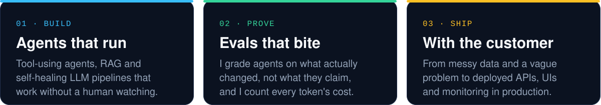

  
  
  
  

## 👋 Who I am

I'm an AI/ML engineer in New York who builds LLM systems and then checks them the way a customer would: **by the answer they produce, not by how confident they sound.**

## Featured work

<table>
  <tr>
    <td width="50%" valign="top">
      
      
<a href="https://github.com/VatsalRoy/lakehouse-sql-eval"><b>Code</b></a> · <a href="https://github.com/VatsalRoy/lakehouse-sql-eval/blob/main/reports/report.md"><b>Full report ↗</b></a>

    </td>
    <td width="50%" valign="top">
      
      
<a href="https://github.com/VatsalRoy/quant-gate"><b>Code</b></a> · <a href="https://github.com/VatsalRoy/quant-gate/actions/runs/42905797336"><b>CI demo run ↗</b></a>

    </td>
  </tr>
  <tr>
    <td width="50%" valign="top">
      
      
<a href="https://github.com/VatsalRoy/keep-it-warm"><b>Code &amp; paper</b></a> · <a href="https://huggingface.co/spaces/vatsal-roy-29/agent-cache-bill-viewer"><b>Trace viewer ↗</b></a>

    </td>
    <td width="50%" valign="top">
      
      
<a href="https://github.com/VatsalRoy/agent-reliability-bench"><b>Code</b></a> · <a href="https://vatsalroy.github.io/agent-reliability-bench/"><b>Explore every run ↗</b></a>

    </td>
  </tr>
</table>

## 🤝 How I fit your team

| If your team needs to… | I've already… |
|---|---|
| **Put LLMs on top of customer data** | Built a text-to-SQL evaluation end to end on Databricks: Lakeflow pipeline, Unity Catalog metric views, MLflow tracking and a Databricks App, deployed as one bundle ([lakehouse-sql-eval](https://github.com/VatsalRoy/lakehouse-sql-eval)) |
| **Know if an agent really works** | Graded agents on database state across 5 runs per task, and showed an LLM judge approved 60% of failing runs ([agent-reliability-bench](https://github.com/VatsalRoy/agent-reliability-bench)) |
| **Ship a smaller, cheaper model safely** | Built a PASS/FAIL quality gate for GGUF files that runs in ~4 minutes in GitHub Actions and rejects broken files in ~30 seconds ([quant-gate](https://github.com/VatsalRoy/quant-gate)) |
| **Keep LLM costs under control** | Measured cost per *solved* question with prompt caching, not just tokens, and found where "savings" backfire ([keep-it-warm](https://github.com/VatsalRoy/keep-it-warm)) |
| **Keep sensitive data out of AI tools** | Built a detector that redacts PII and credentials before a prompt leaves the company, with a live demo ([shadow-ai-privacy-auditor](https://github.com/VatsalRoy/shadow-ai-privacy-auditor)) |
| **Catch regressions before customers do** | Wired nightly regression gates, CI exit codes and reproducible reports into my projects, so quality is checked automatically |
| **Explain results to non-engineers** | Write every project up in plain English: what I expected, what happened, and where it falls short |

## Experience

**Community Dreams Foundation** · *current*  
Anomaly detection in customer behavioral-data pipelines; A/B results turned into self-serve dashboards that product teams use.

**NMR Infotech**  
Standardized feature-engineering frameworks across 8+ client projects (**−25% model dev time**); automated drift monitoring and rollback kept production ML at **99.2% uptime**.

**Full-stack developer** · *where I started*  
React, Node.js and REST APIs, the foundation that lets me ship AI end to end.

🎓 <b>M.S. Computer Science</b>, Long Island University, Brooklyn &nbsp;·&nbsp; <b>B.S. Computer Engineering</b>, Gujarat Technological University

## Toolkit

  

  
  
  
  
  
  
  
  
  
  
  
  
  
  
  
  
  
  
  

---

  <b>Open to Forward Deployed Engineer · AI Engineer · AI/ML Engineer · ML Engineer roles.</b> 
  If you're putting LLMs in front of real customers and need them to be reliable, <a href="mailto:vatsal.roy2429@gmail.com">let's talk</a>.

