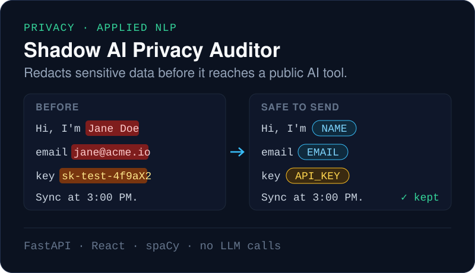
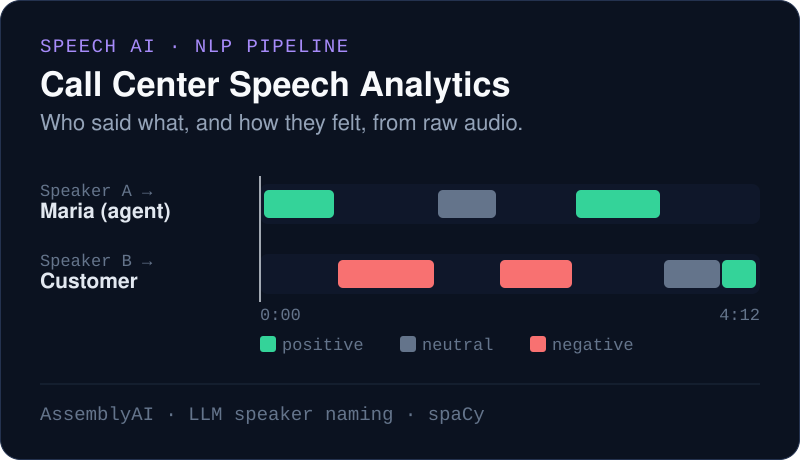

  
  
  
  

 

## Featured work

<table>
  <tr>
    <td width="50%" valign="top">
      
      
<a href="https://github.com/VatsalRoy/agent-reliability-bench"><b>Code</b></a> · <a href="https://vatsalroy.github.io/agent-reliability-bench/"><b>Explore every run ↗</b></a>

    </td>
    <td width="50%" valign="top">
      
      
<a href="https://github.com/VatsalRoy/keep-it-warm"><b>Code &amp; paper</b></a> · <a href="https://huggingface.co/spaces/vatsal-roy-29/agent-cache-bill-viewer"><b>Trace viewer ↗</b></a>

    </td>
  </tr>
  <tr>
    <td width="50%" valign="top">
      
      
<a href="https://github.com/VatsalRoy/shadow-ai-privacy-auditor"><b>Code</b></a> · <a href="https://shadow-ai-frontend.onrender.com"><b>Live demo ↗</b></a>

    </td>
    <td width="50%" valign="top">
      
      
<a href="https://github.com/VatsalRoy/call-center-speech-analytics"><b>Code</b></a>

    </td>
  </tr>
</table>

  
<b>More projects in ML, deep learning &amp; applied AI</b>

   

| | Project | What it does | Built with |
|:-:|---|---|---|
| 🫀 | [**Cardiomegaly Detection**](https://github.com/VatsalRoy/CardiomegalyPridiction) | CNN on 5,447 chest X-rays: **AUC 0.906**, reward-driven hyperparameter search, **3× faster** training | TensorFlow · HDF5 |
| 🌍 | [**Multilingual AI**](https://github.com/VatsalRoy/multilingual-ai) | Q&A over long-form videos in foreign languages | AssemblyAI LeMUR · Claude |
| 🧬 | [**Protein Lab**](https://github.com/VatsalRoy/protein-lab) | ESMFold structure prediction with 3D views and pLDDT confidence | Streamlit · py3Dmol |
| 🎛️ | [**ML Studio**](https://github.com/VatsalRoy/ml-studio) | No-code Random Forest studio: upload a CSV, tune and evaluate live | Streamlit · scikit-learn |
| 🎯 | [**Potential Customer Prediction**](https://github.com/VatsalRoy/Potential-Customer-Prediction) | Lead-conversion classification for an EdTech business | scikit-learn · Pandas |
| 🖼️ | [**Image Classification**](https://github.com/VatsalRoy/imageClassificationDL) | Image classification with CNNs | TensorFlow / Keras |

## Experience

**Community Dreams Foundation** · *current*  
Anomaly detection in customer behavioral-data pipelines; A/B results turned into self-serve dashboards that product teams use.

**NMR Infotech**  
Standardized feature-engineering frameworks across 8+ client projects (**−25% model dev time**); automated drift monitoring and rollback kept production ML at **99.2% uptime**.

**Full-stack developer** · *where I started*  
React, Node.js and REST APIs, the foundation that lets me ship AI end to end.

🎓 <b>M.S. Computer Science</b>, Long Island University, Brooklyn &nbsp;·&nbsp; <b>B.S. Computer Engineering</b>, Gujarat Technological University

## Toolkit

  

  
  
  
  
  
  
  
  
  
  
  
  
  
  
  

---

  <b>Open to Forward Deployed Engineer · AI Engineer · AI/ML Engineer · ML Engineer roles.</b> 
  If you're putting LLMs in front of real customers and need them to be reliable, <a href="mailto:vatsal.roy2429@gmail.com">let's talk</a>.

